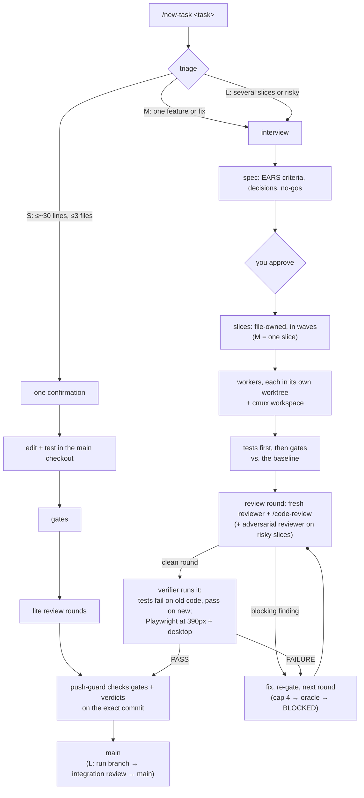

# claude-orchestra

A Claude Code workflow for building apps and websites: triage → interview → spec → parallel worktree workers → gates, a fresh-eyes review-and-fix loop, and verification → guarded push to main.

You describe a task with `/new-task`. Claude sizes it, asks what it needs to know, writes a spec with acceptance criteria, and you approve it. Then it hands the work to one or more **workers**: separate Claude sessions, each in its own git worktree and its own [cmux](https://github.com/manaflow-ai/cmux) workspace. Each worker writes the tests first, implements its slice, passes the repo's gates, goes through fresh review rounds until nothing blocking is left, gets a verifier PASS, and only then pushes. A hook (`push-guard`) checks the evidence before any worker push goes through.

macOS only (cmux and `caffeinate`). Everything installs into `~/.claude`; this repo mirrors that layout.

## How it works



- **Tiers** keep small work cheap. S never starts a worker; M runs one worker that pushes straight to main; L runs the full `orchestrate` flow with up to 3 workers at a time, each pushing to a run branch `orch/<run>` that the coordinator reviews as a whole and pushes to main once.
- **Review loop** (written once in `skills/worker/SKILL.md` §4–5). Each round reviews one gated, squashed commit. A **new** `reviewer` subagent (never shown earlier rounds) and Claude Code's built-in `/code-review` run in parallel; risky slices add an adversarial reviewer in round 1 and before the verifier. The reviewer's BLOCKING items always block; a `/code-review` finding blocks only if it is on lines the diff changes and causes a concrete failure. Blocking findings are fixed at the root cause (plus in-scope advisories), gates rerun, next round. A round with nothing blocking is clean: its advisories go to the report and the `verifier` runs. The same finding in two rounds in a row becomes a question for you; still blocking (or a verifier FAILURE) at round 4 → one `oracle` consult → BLOCKED, and you decide.
- **Verification** is by running things: committed tests must fail on the old code and pass on the new; frontend changes get committed Playwright e2e specs on the worker's own dev-server ports; iOS native criteria get Maestro flows on a per-worker Simulator clone.
- **Supervision** is event-driven: the coordinator wakes on worker messages, `orch-watch` events (dead, stalled, usage limit hit/resumed) or a 30-minute heartbeat. A live dashboard workspace shows what needs you.

Details: [docs/how-it-works.md](docs/how-it-works.md).

## Requirements

| Tool | Needed for | Install |
|---|---|---|
| macOS | cmux, `caffeinate` | — |
| [Claude Code](https://docs.claude.com/en/docs/claude-code) | everything | see its docs |
| cmux | each worker runs in a cmux workspace | `brew install --cask cmux` |
| python3 ≥ 3.9, git | `orch`, push-guard, installer | `xcode-select --install` / `brew install python` |
| gh | creating repos, CI checks | `brew install gh` |
| gitleaks | the secrets gate | `brew install gitleaks` |
| node/npx *(optional)* | Playwright MCP, context7 MCP | `brew install node` |
| Playwright MCP + Google Chrome *(optional, web projects)* | the verifier drives a real browser | the installer sets it up |
| Maestro, xcbeautify *(optional, iOS)* | native slices | [Maestro](https://maestro.mobile.dev) · `brew install xcbeautify` |

**Installing cmux:** `brew install --cask cmux` (or download it from [cmux.dev](https://www.cmux.dev/)), open the app once, and run everything — the installer, `claude`, `/new-task` — from a terminal inside a cmux workspace. `cmux identify --json` printing a `caller` confirms the `cmux` command is on your PATH and you're inside cmux.

## Install

```
git clone https://github.com/amaninderpreetsingh/claude-orchestra
cd claude-orchestra
./install.sh
```

It prints the dependency table first and stops (writing nothing) if a required tool is missing, cmux first. Then it asks up to three questions:

1. **Will you build websites or web apps?** Yes adds the Playwright MCP server at user scope (`claude mcp add -s user playwright -- npx -y @playwright/mcp@latest …`, skipped if you already have one) and installs Playwright's browsers. Workers get the same server from `~/.claude/orchestra/worker-mcp.json`. It needs node/npx: without it the default answer is no, and yes (or `--web`) stops before anything is written.
2. **Add the workflow rules to `~/.claude/CLAUDE.md`?** It appends [CLAUDE.template.md](CLAUDE.template.md) between `<!-- claude-orchestra:start -->` and `<!-- claude-orchestra:end -->`. Your own text is kept; a rerun replaces only that block.
3. **Add `orch` to your PATH in your shell rc?** Asked only for zsh or bash when `~/.claude/orchestra/bin` isn't on your PATH yet; other shells just get the line printed. Default no: it prints the line instead. The skills call `orch` by full path, so this only matters if you want to type it yourself.

Then it copies `skills/`, `agents/`, `orchestra/` and `statusline/` into `~/.claude`, backing up every file it replaces to `~/.claude/backups/claude-orchestra-<timestamp>/`. It never overwrites `settings.json`: it merges in the push-guard hook, the status line (only if you have none) and the deny rules from [settings.example.json](settings.example.json). Last, it runs the test suites (a few minutes; `--skip-tests` skips them).

Flags: `--yes` (take every default without asking), `--web` / `--no-web`, `--skip-tests`. Running it again with the same answers changes nothing. To update, `git pull` and rerun it.

## First run: a throwaway demo

```
~/.claude/orchestra/bin/make-demo-repo
```

This creates `~/orchestra-demo/app` with a local bare `origin` (pushes never leave your Mac) and opens a cmux workspace running `claude` there. Accept the folder-trust prompt, then paste the task it prints (a small tip-calculator page). You'll see the interview, the spec, the dashboard and the worker workspaces open beside the coordinator. Delete `~/orchestra-demo` when you're done. (`make-demo-repo --no-launch [dir]` only creates the repo.)

## Daily use

Open cmux, `cd` into a repo, run `claude` (accept the trust prompt once per repo), and type `/new-task <what you want>`. The first line of the reply is the tier.

| Example | Tier | What happens |
|---|---|---|
| `/new-task fix the typo in the signup button label` | S | One confirmation, edit + test in the main checkout, gates, lite review rounds, push. No workers. |
| `/new-task the settings page crashes when the user has no avatar — repro: …` | M | One interview round, a short spec to approve, one worker in its own workspace, review rounds + verifier, push to main. |
| `/new-task add Stripe checkout with a monthly plan and a billing page` | L | Full interview, spec split into file-owned slices in waves, up to 3 workers in parallel on a run branch, whole-feature review + verification, one push to main. Payments are risky, so it gets an adversarial reviewer too. |
| `/new-task a habit-tracker web app` in an empty folder | L (new app) | Asks name, private/public and stack, creates the GitHub repo, interviews you on the user flows, builds a scaffold slice first (typecheck, lint, tests, build, Playwright, repo `CLAUDE.md`), then the features on top. |

While it runs: answer the questions it asks (each comes with a recommended answer; "yes" accepts it), approve the spec, and check the dashboard's **NEEDS YOU** section. Ask "status" any time. `/new-task --resume <run>` continues a run from its `HANDOFF.md`; `/new-task <task> --answers <file>` runs unattended from an answers file ([example](skills/new-task/answers.example.md)).

## What's inside

| | Name | What it does |
|---|---|---|
| skill | `new-task` | The front door you type: triage S/M/L, then the lite S path, one M worker, or `orchestrate` for L. |
| skill | `orchestrate` | The coordinator: interview, spec, slices, dispatch, supervise ([SUPERVISE.md](skills/orchestrate/SUPERVISE.md)), integrate, report. Never writes feature code. |
| skill | `worker` | One slice in its own worktree: tests first, gates, review rounds, verifier, rebase, guarded push, report. Started by the coordinator. |
| skill | `diagnosing-bugs` | A diagnosis loop for hard bugs and performance regressions. |
| skill | `retro` | `/retro`: a retrospective on a session — misses and the rule, test or hook that prevents each. |
| skill | `writing-for-agents` | How to write skills and `CLAUDE.md` files that agents follow. |
| agent | `reviewer` | Fresh-eyes code review from only the criteria and a git range; records its own verdict. Modes: full, adversarial, lite (tier S). |
| agent | `verifier` | Proves the change works by running it (tests, Playwright, Maestro, emulators); records per-criterion results. |
| agent | `oracle` | Read-only second opinion when a worker is stuck. |
| agent | `ci-monitor` | Watches GitHub Actions for one pushed commit and reports one PASS/FAIL line. |
| tool | `orchestra/bin/orch` | State, locks, ports, evidence (gates, verdicts), spawning/closing workers, dashboard. `orch --help`. |
| tool | `orch-watch` | Waits for the next worker event (dead, stalled, usage limit) for the coordinator. |
| tool | `orch-sim` | One iOS Simulator clone per worker, so native checks run in parallel. |
| tool | `memory-lint` | Checks a project memory directory (frontmatter, index, duplicates). |
| tool | `make-demo-repo` | The throwaway demo above. |
| hook | `orchestra/hooks/push-guard.py` | PreToolUse hook on Bash: enforces the push and messaging rules below. |
| | `statusline/statusline.py` | Status line: context %, plus 5-hour and weekly usage with reset times. |
| | `orchestra/worker-mcp.json` | The only MCP servers workers load (Playwright, context7), to save memory; `orch spawn --native` skips it so iOS Simulator slices keep cmux Computer Use. |

More on the commands: [orchestra/README.md](orchestra/README.md).

## Safety model

- **push-guard decides, not prompts.** Inside a worker's worktree a push is allowed only as one plain `git push origin HEAD:<its branch>`, on top of the latest remote, with gates + reviewer + verifier PASS recorded on that exact commit, while it holds the repo's merge lock. Any error denies the push. Force and delete pushes are denied everywhere.
- **No self-certification.** Only the reviewer and verifier agents can record their verdicts; a worker can't.
- **One-way messaging.** Workers only send tagged reports and questions to their own coordinator; they can't message each other or drive other terminals.
- **Tiers bind the main checkout too.** An S change pushes only with gates + a lite reviewer PASS on that commit; an M/L change never ships from the main checkout.
- **Never production.** The rules treat any resource as production unless proven otherwise and never write to anything matching `prod|production`; tests and verifiers use emulators and test accounts.
- **Conservative settings.** `settings.example.json` adds no allow rules, no default permission mode and no model choice — only the hook, the status line and deny rules for the common spellings of a force-push and of `rm -rf /`, `~`, `$HOME`. The deny rules are a backstop that matches text; push-guard is what denies every force push, however it's written.
- **Compound commands prompt.** push-guard never auto-approves a compound command, so outside workers your own permission rules decide: with these settings something like `git add -A && git commit -m …` asks for permission. Unattended runs need workers started in auto mode (`orch spawn` does this) or your own matching allow rules. Inside a worker a compound command containing a push is denied, so a push must be one plain `git push origin HEAD:<target>` with the branch written out (no `cd`, variables or `$(…)`). Inside a worker, when unsure, the guard denies. Known limits are listed in the header of `orchestra/hooks/push-guard.py`.

## Token cost

This trades tokens for quality. An L run starts several Opus sessions (coordinator + up to 3 workers), and every review round adds a reviewer, a `/code-review` agent and, at the end, a verifier. A typical feature can use many times the tokens of doing it in one chat. Use `/new-task` and let triage pick S or M when the task is small. Each worker also uses about 1 GB of memory.

## Uninstall

```
./uninstall.sh
```

From the clone. It removes every file the installer copied and restores what it replaced, removes the `claude-orchestra` block from `CLAUDE.md`, the hook / status line / deny entries it merged into `settings.json`, and the PATH line if it added one. It keeps run history under `~/.claude/orchestra/runs`, `~/.claude/backups`, and the Playwright MCP server (`claude mcp remove -s user playwright`). A file you edited after installing is moved to a backup instead of deleted.

## FAQ and troubleshooting

**A worker workspace opens and sits at a prompt.** That folder isn't trusted yet. `orch spawn` refuses untrusted folders and puts the step under NEEDS YOU: run `claude` in the repo once, accept the trust prompt, `/exit`, then tell the coordinator.

**`install.sh` says cmux is missing.** `brew install --cask cmux`, open cmux once, and rerun the installer from a cmux terminal. Check with `cmux identify --json` (it prints a caller when run inside cmux). The coordinator itself must run inside a cmux workspace.

**The coordinator says Playwright is missing.** For web repos it checks `claude mcp list` for `playwright`, `~/.claude/orchestra/worker-mcp.json`, and Google Chrome. Install node/npx if needed (`brew install node`), then rerun `./install.sh --web`, or `claude mcp add --scope user playwright -- npx -y @playwright/mcp@latest --browser chrome --isolated --headless`, and install Google Chrome (`brew install --cask google-chrome`).

**Everything asks for permission.** Expected with the conservative settings: workers run in auto mode, your own sessions follow your permission rules. Add allow rules for the commands you trust; never allow-all Bash.

**A push was denied.** Read the reason: push-guard names what's missing (gates, a verdict on this commit, the merge lock, a rebase). Fix that; never work around it.

**A worker is BLOCKED.** It hit the 4-round cap or a question only you can answer. The coordinator asks you: restart fresh (from the worker's `## Learned` notes), re-scope, or drop the slice.

**Where is the state?** `~/.claude/orchestra/runs/<run>/` holds the spec, criteria, briefs, progress files, artifacts and screenshots.

## Credits and license

MIT — see [LICENSE](LICENSE). `diagnosing-bugs`, `retro` and `writing-for-agents` are adapted from [Matt Pocock's skills](https://github.com/mattpocock/skills) (MIT); see [NOTICE](NOTICE).
