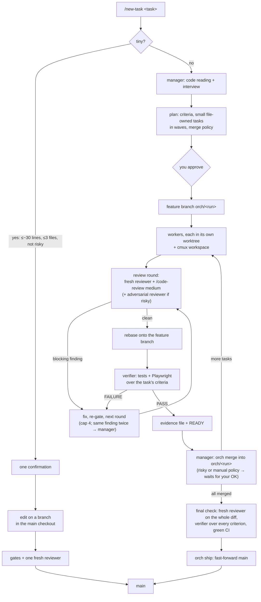

# claude-orchestra

A Claude Code workflow for building apps and websites: a tiny fast path for small edits, and for everything else a plan of small tasks run by parallel worktree workers, each reviewed until clean and proven by tests, merged by a manager into one feature branch, checked as a whole, then shipped to main.

You describe a task with `/new-task`. A tiny change (≤~30 lines, ≤3 files, not risky) is confirmed once and done directly. Anything else goes to the **manager** (the `orchestrate` skill, running in your chat; the guard's messages and `orch` call the same role the coordinator): it reads the code, interviews you, writes a plan of small file-owned tasks in waves, and you approve it. Then it hands each task to a **worker**: a separate Claude session in its own git worktree and its own [cmux](https://github.com/manaflow-ai/cmux) workspace. A worker does its task, loops fresh reviews until nothing blocking is left, proves its criteria with tests and Playwright, writes an evidence file and reports `READY`. Workers never push: the manager merges each READY task into the run's feature branch, and ships that branch to main after a final check.

macOS only (cmux and `caffeinate`). Everything installs into `~/.claude`; this repo mirrors that layout.

## How it works



- **Two paths.** Tiny: no run, worker or worktree — an edit on a branch in your main checkout, the gates, one fresh `reviewer`, push. Everything else: a plan (one task is fine) on one feature branch `orch/<run>`, up to 3 workers at a time.
- **Review loop** (`skills/worker/SKILL.md` §4). Each round reviews one gated commit with **new** agents that never saw earlier rounds: a `reviewer` plus Claude Code's built-in `/code-review medium`, and an adversarial reviewer on risky tasks (auth, security rules, payments, data writes/migrations, CI/test infra). A finding blocks only if it causes a wrong result, crash, hang, fail-open or data loss on lines the diff changes. The worker fixes every blocking finding and runs another round, until one comes back clean. The same finding open two rounds running, or still blocking after 4 rounds, goes to the manager as `BLOCKED`: it decides to fix differently, accept the finding, or ask you.
- **Merging.** A worker ends with `READY: <id> <sha> evidence=<path>`. The manager checks the evidence file and runs `orch merge`, which fast-forwards the feature branch to the worker's commit and pushes it. The plan's merge policy is `auto` by default; risky tasks and every task under `manual` wait for your OK. After each merge the other workers rebase.
- **Final check, then ship.** Once every task is merged: a fresh reviewer reads the whole feature diff, a verifier runs every acceptance criterion end to end, the gates run against the baseline, and CI on the branch head must be green. Then `orch ship` fast-forwards main to the feature branch.
- **Verification** is by running things: committed tests must fail on the old code and pass on the new; frontend criteria get committed Playwright e2e specs at 390px and desktop on the worker's own dev-server ports. What can't run here (a device, a real account) is listed as not exercised.
- **Supervision** is event-driven: the manager wakes on worker messages, `orch-watch` events (dead, stalled, usage limit hit/resumed) or a 30-minute heartbeat. A live dashboard workspace shows what needs you; the manager's questions and approvals there also send you one notification each (a "trust this folder" step from `orch spawn` only shows on the dashboard).

Details: [docs/how-it-works.md](docs/how-it-works.md).

## Requirements

| Tool | Needed for | Install |
|---|---|---|
| macOS | cmux, `caffeinate` | — |
| [Claude Code](https://docs.claude.com/en/docs/claude-code) | everything | see its docs |
| cmux | each worker runs in a cmux workspace | `brew install --cask cmux` |
| python3 ≥ 3.9, git | `orch`, push-guard, installer | `xcode-select --install` / `brew install python` |
| gh | creating repos, CI checks | `brew install gh` |
| gitleaks | the secrets gate | `brew install gitleaks` |
| node/npx *(optional)* | Playwright MCP, context7 MCP | `brew install node` |
| Playwright MCP + Google Chrome *(optional, web projects)* | the verifier drives a real browser | the installer sets it up |

**Installing cmux:** `brew install --cask cmux` (or download it from [cmux.dev](https://www.cmux.dev/)), open the app once, and run everything — the installer, `claude`, `/new-task` — from a terminal inside a cmux workspace. `cmux identify --json` printing a `caller` confirms the `cmux` command is on your PATH and you're inside cmux.

## Install

```
git clone https://github.com/amaninderpreetsingh/claude-orchestra
cd claude-orchestra
./install.sh
```

It prints the dependency table first and stops (writing nothing) if a required tool is missing, cmux first. Then it asks up to three questions:

1. **Will you build websites or web apps?** Yes adds the Playwright MCP server at user scope (`claude mcp add -s user playwright -- npx -y @playwright/mcp@latest …`, skipped if you already have one) and installs Playwright's browsers. Workers get the same server from `~/.claude/orchestra/worker-mcp.json`. It needs node/npx: without it the default answer is no, and yes (or `--web`) stops before anything is written.
2. **Add the workflow rules to `~/.claude/CLAUDE.md`?** It appends [CLAUDE.template.md](CLAUDE.template.md) between `<!-- claude-orchestra:start -->` and `<!-- claude-orchestra:end -->`. Your own text is kept; a rerun replaces only that block.
3. **Add `orch` to your PATH in your shell rc?** Asked only for zsh or bash when `~/.claude/orchestra/bin` isn't on your PATH yet; other shells just get the line printed. Default no: it prints the line instead. The skills call `orch` by full path, so this only matters if you want to type it yourself.

Then it copies `skills/`, `agents/`, `orchestra/` and `statusline/` into `~/.claude`, backing up every file it replaces to `~/.claude/backups/claude-orchestra-<timestamp>/`, and removes files an earlier version installed that this one no longer ships (unless you changed them). It never overwrites `settings.json`: it merges in the push-guard hook, the status line (only if you have none) and the deny rules from [settings.example.json](settings.example.json). Last, it runs the test suites (a few minutes; `--skip-tests` skips them).

Flags: `--yes` (take every default without asking), `--web` / `--no-web`, `--skip-tests`. Running it again with the same answers changes nothing. To update, `git pull` and rerun it.

## First run: a throwaway demo

```
~/.claude/orchestra/bin/make-demo-repo
```

This creates `~/orchestra-demo/app` with a local bare `origin` (pushes never leave your Mac) and opens a cmux workspace running `claude` there. Accept the folder-trust prompt, then paste the task it prints (a small tip-calculator page). You'll see the interview, the plan, the dashboard and the worker workspaces open beside the manager. Delete `~/orchestra-demo` when you're done. (`make-demo-repo --no-launch [dir]` only creates the repo.)

## Daily use

Open cmux, `cd` into a repo, run `claude` (accept the trust prompt once per repo), and type `/new-task <what you want>`. The first line of the reply is the path: `Path: tiny | plan — <reason>`.

| Example | Path | What happens |
|---|---|---|
| `/new-task fix the typo in the signup button label` | tiny | One confirmation, an edit on a branch in the main checkout, gates, one fresh reviewer, push to main. No workers. |
| `/new-task the settings page crashes when the user has no avatar — repro: …` | plan | One confirmation round, a one-task plan to approve, one worker, review rounds + tests, merged into the feature branch, final check, shipped to main. |
| `/new-task add Stripe checkout with a monthly plan and a billing page` | plan | Full interview, a plan of file-owned tasks in waves, up to 3 workers in parallel. Payments are risky: those tasks get an adversarial reviewer and wait for your OK before they merge. |
| `/new-task a habit-tracker web app` in an empty folder | plan (new app) | Asks name, private/public and stack, creates the GitHub repo, interviews you on the user flows, builds a scaffold task first (typecheck, lint, tests, build, Playwright, repo `CLAUDE.md`), then the features on top. |

While it runs: answer the questions it asks (each comes with a recommended answer; "yes" accepts it), approve the plan, and check the dashboard's **NEEDS YOU** section (each question or approval the manager adds there also sends you one notification). Ask "status" any time. `/new-task --resume <run>` continues a run from its `HANDOFF.md`; `/new-task <task> --answers <file>` runs unattended from an answers file ([example](skills/new-task/answers.example.md)).

## What's inside

| | Name | What it does |
|---|---|---|
| skill | `new-task` | The front door you type: the tiny fast path, or `orchestrate` for everything else. |
| skill | `orchestrate` | The manager: code reading, interview, plan, dispatch, supervise ([SUPERVISE.md](skills/orchestrate/SUPERVISE.md)), merge, final check, ship, report. Never writes feature code. |
| skill | `worker` | One task in its own worktree: do it, review loop, rebase, tests/Playwright, evidence file, `READY`. Never pushes. Started by the manager. |
| skill | `diagnosing-bugs` | A diagnosis loop for hard bugs and performance regressions. |
| skill | `retro` | `/retro`: a retrospective on a session — misses and the rule, test or hook that prevents each. |
| skill | `writing-for-agents` | How to write skills and `CLAUDE.md` files that agents follow. |
| agent | `reviewer` | Fresh-eyes code review from only the criteria and a git range; returns a verdict and findings with stable ids. Modes: full, re-review, adversarial, final. |
| agent | `verifier` | Proves the change works by running it (tests, Playwright, emulators); returns per-criterion results. |
| agent | `oracle` | Read-only second opinion when a worker or the manager is stuck. |
| agent | `ci-monitor` | Watches GitHub Actions for one pushed commit and reports one PASS/FAIL line. |
| tool | `orchestra/bin/orch` | Run state, the feature branch, merge and ship, file locks, ports, spawning/closing workers, dashboard. `orch --help`. |
| tool | `orch-watch` | Waits for the next worker event (dead, stalled, usage limit) for the manager, and types `continue` into a paused session after its usage limit resets. |
| tool | `memory-lint` | Checks a project memory directory (frontmatter, index, duplicates). |
| tool | `make-demo-repo` | The throwaway demo above. |
| hook | `orchestra/hooks/push-guard.py` | PreToolUse hook on Bash: the three rules below. |
| | `statusline/statusline.py` | Status line: context %, plus 5-hour and weekly usage with reset times. |
| | `orchestra/worker-mcp.json` | The only MCP servers workers load (Playwright, context7), to save memory; `orch spawn --all-mcp` gives a worker all of yours. |

More on the commands: [orchestra/README.md](orchestra/README.md).

## Commands you might type

| Command | What |
|---|---|
| `orch status` | every active run and its workers |
| `orch report --run <run>` | the status table, now |
| `orch dash --run <run> --open` | reopen the live dashboard workspace |
| `orch doctor --run <run> [--fix]` | dead workers, orphan locks (+ the respawn command) |
| `orch locks --repo <path>` | who owns which files |
| `orch criteria-check --run <run>` | acceptance criteria status |
| `orch reap [--run <run>] [--dry-run]` | clean up anything finished or dead that still uses memory |
| `orch end-run --run <run> --status aborted` | abandon a run: closes its workspaces, stops its processes, removes its worktrees |
| `orch gc [--ended-older-than 14d] [--dry-run]` | shrink runs that ended long ago |
| `memory-lint <memory dir>` | check a project memory dir |

The manager runs the rest itself (`new-run`, `run-branch`, `spawn`, `merge`, `ship`, `note`, …); see [orchestra/README.md](orchestra/README.md).

## Safety model

push-guard is a **guard-rail against accidents, not a sandbox**. It is a `PreToolUse` hook on every Bash command that scans the command text (no shell parser) and enforces exactly three rules:

1. **Nobody force-pushes** — `--force`, `-f` (also in a cluster like `-uf`), `--force-with-lease`, `--force-if-includes`, `--mirror` or a `+` refspec, in a worker or anywhere else. A delete push (`--delete`, `:<branch>`) is not a force push and is allowed outside workers.
2. **A registered worker never pushes.** Any `git … push` from a worker's worktree is denied; the manager merges and pushes.
3. **A worker's cmux is limited** to messaging its own manager (`cmux agent message <its manager>`, `cmux agent message --reply-to <id>`) and read-only verbs (`identify`, `read-screen` of its own surface). Messaging other workers, setting `CMUX_*` variables or `orch broadcast` are denied.

It never approves or prompts: a command it doesn't deny gets no decision, so your own permission rules decide every other command, your own pushes and commits included. It knows a worker by the directory the command runs in (a worktree with an `orch register` record), so a worker that `cd`s out of its worktree is no longer treated as one; a script written to a file and then run, a verb built in a variable or an alias also gets past it; it exists so an agent's mistake fails loudly, not to stop a determined one. It loads on macOS's `/usr/bin/python3` (3.9) and fails closed on runtime errors: if it crashes, is stopped, or runs out of time, it denies any command naming push, cmux or broadcast. If it can't run at all (no `python3`, one that can't compile it, or a missing `push-guard.py`), the hook command refuses every Bash command with `push-guard failed to run (exit N); refused` rather than let commands through unguarded — the installer's python3 check catches that before installing.

Beyond the guard:
- **Only the manager merges, and only under the plan's policy.** `orch merge` refuses unless the evidence file's sha, the `--sha` it was given and the worker's branch head all match and the merge is a fast-forward; risky tasks and a `manual` plan wait for your OK. `orch ship` only fast-forwards main, never forces.
- **Never production.** The rules treat any resource as production unless proven otherwise and never write to anything matching `prod|production`; tests and verifiers use emulators and test accounts.
- **Conservative settings.** `settings.example.json` adds no allow rules, no default permission mode and no model choice — only the hook, the status line and deny rules for the common spellings of a force-push and of `rm -rf /`, `~`, `$HOME`. Workers start in auto mode (`orch spawn` does this); your own sessions follow your permission rules.
- **Cleanup touches only orchestra's own.** `orch reap` / `close` / `end-run` stop only processes orchestra can tie to a run (in its worktrees, or on a port block it allocated); a process on a port orchestra never allocated is left alone, even inside its port range.
- **An abandoned run keeps the Mac awake.** `caffeinate` is released only by `orch end-run`, when no other run is active, or by `orch reap` once no run is active or no active run has had a live worker for 12 h, and both run from the manager. Close a run's chat and the Mac stays awake: continue it with `/orchestrate --resume <run>`, or end it with `orch end-run --run <run> --status aborted`, which also removes its worktrees and deletes the remote `orch/<run>`; work that never reached main stays in your repo's local `orch/<run>` branch (the remote is kept only if it has commits even that branch lacks). Only the default state dir `~/.claude/orchestra` holds it: under any other `ORCH_HOME` (a test, a probe) orchestra holds none unless you set `ORCH_CAFFEINATE=caffeinate`.

## Token cost

This trades tokens for quality. A plan starts several Opus sessions (the manager + up to 3 workers), and every review round adds a reviewer and `/code-review`, then a verifier per task and a final reviewer + verifier for the whole branch. A typical feature can use many times the tokens of doing it in one chat. Use `/new-task` and let it take the tiny path when the change is small. Each worker also uses about 1 GB of memory.

## Uninstall

```
./uninstall.sh
```

From the clone. It removes every file the installer copied and restores what it replaced, removes the `claude-orchestra` block from `CLAUDE.md`, the hook / status line / deny entries it merged into `settings.json`, and the PATH line if it added one. It keeps run history under `~/.claude/orchestra/runs`, `~/.claude/backups`, and the Playwright MCP server (`claude mcp remove -s user playwright`). A file you edited after installing is moved to a backup instead of deleted.

## FAQ and troubleshooting

**A worker never starts.** That folder isn't trusted yet. `orch spawn` refuses untrusted folders and puts the step under NEEDS YOU: run `claude` in the repo once, accept the trust prompt, `/exit`, then tell the manager.

**`install.sh` says cmux is missing.** `brew install --cask cmux`, open cmux once, and rerun the installer from a cmux terminal. Check with `cmux identify --json` (it prints a caller when run inside cmux). The manager itself must run inside a cmux workspace.

**The manager says Playwright is missing.** For web repos it checks `claude mcp list` for `playwright`, `~/.claude/orchestra/worker-mcp.json`, and Google Chrome. Install node/npx if needed (`brew install node`), then rerun `./install.sh --web`, or `claude mcp add --scope user playwright -- npx -y @playwright/mcp@latest --browser chrome --isolated --headless`, and install Google Chrome (`brew install --cask google-chrome`).

**Everything asks for permission.** Expected with the conservative settings: workers run in auto mode, your own sessions follow your permission rules. Add allow rules for the commands you trust; never allow-all Bash.

**Every Bash command is blocked after I deleted `~/.claude/orchestra`.** The hook in `settings.json` still points at `push-guard.py`, and a missing hook script blocks every Bash call. Remove the push-guard hook entry from `~/.claude/settings.json` (`./uninstall.sh` can't: it needs the install manifest that lived in that folder).

**Every Bash command is refused with `push-guard failed to run (exit N); refused`.** The hook couldn't run the guard (no `python3` on PATH, one that can't load it, or `push-guard.py` missing), so it refuses everything rather than run unguarded. From a terminal, put a `python3` ≥ 3.9 the hook loads with first on PATH (`brew install python`), or rerun `./install.sh`: its python3 check loads the hook and reports what fails.

**A command was denied by push-guard.** It names the rule in one line:
- `Force pushes are never allowed (--force, -f, --force-with-lease, --force-if-includes, --mirror, a + refspec). Rebase onto the remote branch and push normally.` — anywhere. Rebase and push normally; never work around it.
- `Workers never push. Commit on your branch, then report to your coordinator: READY: <id> <sha> evidence=<path> — the manager merges and pushes it.` — a worker tried to push. That is the design: it reports READY instead.
- `Workers never message other workers. Report to your coordinator instead.` / `Workers message only their coordinator (…).` / `Workers may run only these cmux commands: …` / `Workers never set CMUX_* variables …` — a worker used cmux outside rule 3.
- `From a worker, write cmux commands plainly, not inside text another program runs: …` — a worker named cmux or broadcast inside text another interpreter runs (`python -c`, `node -e`, …) or that can't be split into words; write it as a plain command. (Text a shell runs — `sh -c`, `eval` — is checked like any command and gets the rule's own message.)
- `push-guard error (…); refused (push/cmux/broadcast)` — the hook itself failed (crash, signal, timeout) and denied a command naming push, cmux or broadcast. It can't run on your `python3` (too old, or it fails to load the hook) → install a `python3` ≥ 3.9 the hook loads with (`brew install python`) first on PATH, or rerun `./install.sh`: its python3 check loads the hook and reports what fails.

**A worker is BLOCKED.** Its review loop hit the 4-round cap, the same finding came back two rounds running, or it is stuck. The manager reads its notes and decides: fix differently, accept the finding, or ask you (restart fresh from the worker's `## Learned` notes, re-scope, or drop the task).

**A merge is waiting for me.** A risky task, or a plan with `merge_policy: manual`. It shows under the dashboard's NEEDS YOU (one notification), and the manager asks you with the task, the sha and a summary of its evidence; say OK (or what to change) in the manager's chat.

**Where is the state?** `~/.claude/orchestra/runs/<run>/` holds the spec, plan, criteria, briefs, progress and evidence files, artifacts and screenshots.

## Credits and license

MIT — see [LICENSE](LICENSE). `diagnosing-bugs`, `retro` and `writing-for-agents` are adapted from [Matt Pocock's skills](https://github.com/mattpocock/skills) (MIT); see [NOTICE](NOTICE).
